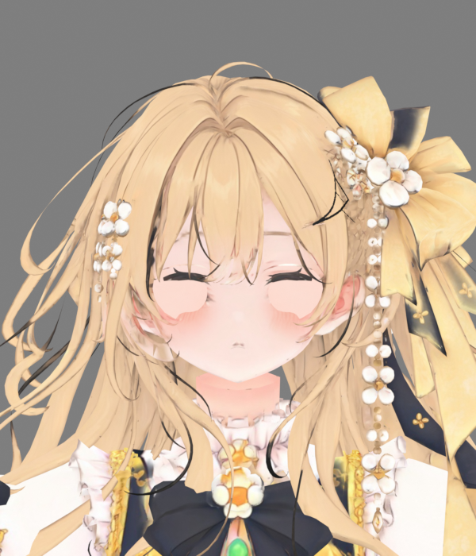

# ななたう / nanatau

<p align="center">
  
  <br>
  <strong>涙を魔力に変える、ちょっぴり泣き虫な魔法少女。</strong>
  <br>
  <sub>キャラクターデザイン・3Dモデル・素材をまとめた、ななたうの制作ノート。</sub>
</p>

## 3Dのななたう

2026-10-24、顔立ちを保ったまばたきと笑顔の修正版を正本に採用しました。表情は0〜100%でなめらかに変化し、まばたきと笑顔を重ねられます。

<table>
  <tr>
    <td align="center" width="50%">
      <a href="images/concept/avatar-v1/charakuru/face-neutral.png">
        
      </a>
      <br>
      <sub>いつもの顔。きらきらの瞳と、お花の髪飾り。</sub>
    </td>
    <td align="center" width="50%">
      <a href="images/concept/avatar-v1/charakuru/front.png">
        
      </a>
      <br>
      <sub>リボンもフリルも、いつものななたう。<br>全身の参考画像（表情追加前）。</sub>
    </td>
  </tr>
  <tr>
    <td align="center" width="50%">
      <a href="images/concept/avatar-v1/charakuru/face-blink.png">
        
      </a>
      <br>
      <sub>そっと目を閉じて、まばたき。</sub>
    </td>
    <td align="center" width="50%">
      <a href="images/concept/avatar-v1/charakuru/face-happy.png">
        
      </a>
      <br>
      <sub>目を開けたまま、ちょっぴりにっこり。</sub>
    </td>
  </tr>
</table>

<p align="center">
  ふわりと揺れる髪と衣装まで、Charakuruで3Dに。
  <br>
  <sub>VRM 1.0 · MToon · まばたきと笑顔 · 髪と衣装の揺れ物</sub>
</p>

| 楽しみ方 | 確認先 |
| --- | --- |
| 最新の表情付きダンスを見る | [テトリス](models/avatar-v1/charakuru/videos/dance-tetris-expressions.mp4)：まばたき4回・笑顔3区間、約15.87秒・1080×1350・30fps・公式伴奏付き |
| モデルを使う | [VRM](models/avatar-v1/charakuru/avatar.vrm)：現在の正本。MToon・まばたき・笑顔に対応 |
| モデルを編集する | [Blend](models/avatar-v1/charakuru/avatar.blend)：現在の表情を含む編集用正本 |
| ダンスを見る | [Samba Dancing](models/avatar-v1/charakuru/videos/dance-demo.mp4)：18.2秒・1080×1080・無音 |
| 音付きショートを見る | [愛包ダンスホール](models/avatar-v1/charakuru/videos/dance-short.mp4)：16秒・720×1280 |
| 画像を見る | [現在の3表情と、表情追加前の全身・6方向・動作確認画像](images/concept/avatar-v1/charakuru/README.md) |

仕様・利用条件・検証結果・現在の制約は、[Charakuru版の成果物一覧](models/avatar-v1/charakuru/README.md)へ。

## Character Prompt

> Quiet bravery in vulnerability.

```text
Soft pale yellow hair, warm golden amber eyes with layered highlights,
pastel yellow and white magical girl outfit, delicate frame.
Expression is introverted, fragile, and trying-her-best:
teary, sleepy, embarrassed, but gentle.
Clean thin-to-medium lineart, flat cel shading, minimal warm background.
Palette is strictly Pale Butter Yellow (#FFFDE7),
Soft Navy (#2C3E6B), Warm White (#FFF8E1).
```

## Getting Started

### Showcase site

The React/TypeScript showcase is managed independently in `site/`.

```bash
cd site
bun install
bun run dev
```

Open the URL printed by Vite, usually <http://localhost:5173/>.

### Blog

The blog uses Lume and Deno.

```bash
cd blog
deno task serve
```

## Usage

```bash
# Root secret scanning
bun install
bun run secretlint

# Showcase typecheck and production build
cd site
bun run typecheck
bun run build
bun run preview
bun run deploy:dry-run
bun run deploy

# Blog production build
cd ../blog
deno task build
```

## Directory

- `images/`: approved source assets
- [models/](models/README.md): adopted 3D models, videos, and verification records
- `output/`: generated work files and source materials, excluded from Git
- `site/`: React/TypeScript/Vite showcase site
- `blog/`: Lume-based blog
- `.claude/skills/motion-pngtuber-nanatau/`: MotionPNGTuber skill and scripts

## MotionPNGTuber

動画ベースの MotionPNGTuber パイプラインは `.claude/skills/motion-pngtuber-nanatau/` に集約している。

- 作業中の成果物: `output/` 配下（セットごとの作業ディレクトリは必要時に作成）
- 正本: `images/png-tuber/motion/<set-name>/`
- 標準検証: `.claude/skills/motion-pngtuber-nanatau/scripts/verify_server.py --mode stub`
